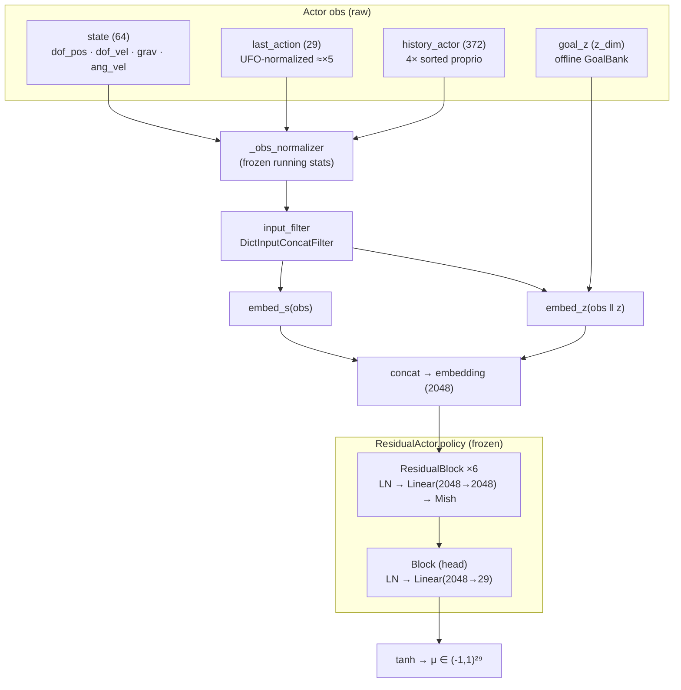
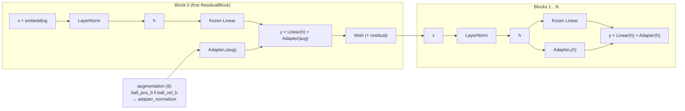
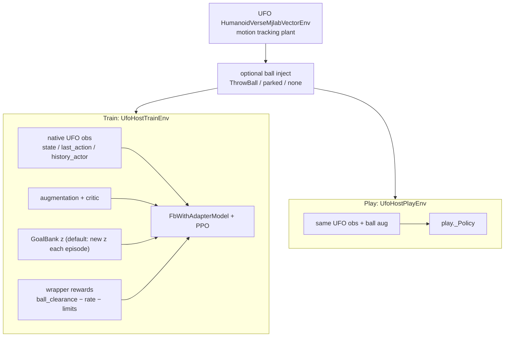

# `humanoidverse.adapt_fb`

ORCS-style LoRA dodge adaptation on a **frozen** UFO-FB policy.

## Design

| Piece | Source |
|-------|--------|
| Frozen actor + goal `z` | UFO checkpoint / existing `goal_inference` pickle (read-only) |
| Proprio / action / history | **Shared UFO host** (`HumanoidVerseMjlabVectorEnv`) for train + play |
| LoRA + PPO | This package (`FbWithAdapter` / vendored `rsl_rl`) |
| Ball | Injected into UFO mjlab scene (`ThrowBall`); play `--ball none\|parked\|throw` |

UFO core train / eval / `goal_inference` are **not** modified. Play does not rewrite `goal_reaching.pkl` or videos.

**Status (2026-10):** train/play share the UFO host; short smoke (~300 iters) ran without crash.
**Formal multi-GPU training and play evaluation are not done yet** — planned next.

---

## Model architecture (UFO-FB base)

Frozen path matches UFO `FBcprAuxModel.act` → `FBModel.actor` → `ResidualActor`:



At inference / play, `model.act(obs, z)` already runs `_normalize` inside `actor()`.  
`FbWithAdapter.forward` does the same normalize, then reimplements the policy stack so LoRA can be interleaved.

---

## How LoRA is inserted (unchanged contract)

Only **`ResidualActor.policy` Linears** get adapters (embeddings stay frozen), matching ORCS / `MLPWithAdapter` interleaving:



| Adapter | Conditioning input | Rank (default `rank=16`) |
|---------|-------------------|---------------------------|
| `adapters[0]` | **normalized** `augmentation` (6) | clamped to `min(rank, in-1)` → **5** when `aug_dim=6` |
| `adapters[1…]` | post-LN hidden `h` (2048) | low-rank 16 |
| last head | `h` → action dim 29 | low-rank 16 |

Zero-init (`up` / `delta` weights = 0) ⇒ fresh LoRA is **bit-exact** with `act_base`.  
Subsequent adapters always see `h`, so a trained LoRA can change actions even when `aug=0`.

Trainable params: `adapters.*` + `adapter_normalizer` (+ optional dist std). Everything under `adapted.frozen` stays frozen.

---

## Train vs play (unified UFO host)



Action scaling (both paths): policy `tanh` ≈ `[-1,1]` → UFO `normalize_action` (×5).  
Legacy `DodgeFbVecEnv` + `dodge_env_cfg` remain for unit tests / smoke; production train uses the UFO host.

---

## Training intent (multi-z dodge)

Not “stand forever and dodge”. Per episode:

1. Sample (or fix) one `goal_z` → frozen UFO-FB tries to **hold that skill**.
2. Ball flies → PPO on LoRA maximizes `ball_clearance` (dodge).
3. Ball parks again → base should **recover the same goal**; LoRA should go quiet.

Multi-z = many episodes, each with its own goal → dodge under many skills.  
ORCS’s `station` reward is the stand-only special case of “return to reference”; AdaptFb’s reference is **`goal_z`**, carried by the frozen base (no stand station wired by default).

## Known failure of the first 8-GPU run

Legacy `UFO-FB-adapt/.../model_7999.pt` falls immediately — even on the training dodge plant, even with `aug=0`. Confirmed issues:

1. **First adapter silently full-rank** — `rank=16` with `aug_dim=6` became `Linear(6→2048)`. **Fixed:** rank clamp → low-rank 5.
2. Play dropped `adapter_normalizer` (**fixed**).
3. `ball_clearance` saturates while the ball is parked → weak pressure to keep LoRA near the base between throws (ORCS uses stand-station; we rely on the frozen FB+`z` prior instead — do **not** add default-pose station if you want non-stand goals).

Old 7999 is not expected to recover; retrain with the rank/normalizer fixes.

---

## Play

`--agent` modes (A/B/C contrasts):

| Mode | Weights | Forward |
|------|---------|---------|
| `base` | original UFO-FB | `act_base` (no LoRA) |
| `adapted-base` | AdaptFb ckpt frozen stem | `act_base` (vs `base`) |
| `adapted` | AdaptFb ckpt stem + LoRA + normalizer | full (vs `adapted-base`) |

Aliases: `initial`→`base`, `trained`→`adapted`.

From the UFO repo root:

```bash
export PYTHONPATH="$PWD${PYTHONPATH:+:$PYTHONPATH}"
export DISPLAY=:1   # if using container VNC / noVNC

# Original UFO-FB
python -m humanoidverse.adapt_fb.play --agent base --ball none --viewer native --device cuda:0
python -m humanoidverse.adapt_fb.play --agent base --ball parked --viewer native --device cuda:0
python -m humanoidverse.adapt_fb.play --agent base --ball throw --viewer native --device cuda:0

# Post-train ckpt stem only / full LoRA (needs --adapter-ckpt)
python -m humanoidverse.adapt_fb.play --agent adapted-base \
  --adapter-ckpt runs/adapt_fb_ufo_host_300/model_299.pt \
  --ball throw --viewer native --device cuda:0
python -m humanoidverse.adapt_fb.play --agent adapted \
  --adapter-ckpt runs/adapt_fb_ufo_host_300/model_299.pt \
  --ball throw --viewer native --device cuda:0
```

Keys: `n`/`b` cycle goal; Space pause; Enter reset; `+/-` speed.

Needs `runs/ufo_fb_8gpu/checkpoint` and `runs/ufo_fb_8gpu/goal_inference/goal_reaching.pkl`
(or `UFO_FB_CHECKPOINT` / `UFO_FB_GOAL_PKL`).

---

## Train

From the UFO repo root (cwd matters — checkpoints under **`UFO/runs/`**).
Train builds the same UFO host as play, with `ball=throw` + contact terminations.

```bash
# single GPU (default: new goal_z each episode reset)
python -m humanoidverse.adapt_fb.train --num-envs 64 --max-iterations 500 \
  --log-dir runs/adapt_fb_dodge

# 8 GPU
python -m humanoidverse.adapt_fb.train_ddp --num-envs 4096 --max-iterations 8000 \
  --log-dir runs/adapt_fb_dodge_8gpu

# optional: one fixed goal for all envs
python -m humanoidverse.adapt_fb.train ... --single-z
```

Writes `runs/adapt_fb_dodge*/model_*.pt` (+ TensorBoard). Prefer these over legacy `UFO-FB-adapt/runs/...`.
Checkpoints are full actor dumps (frozen UFO-FB + LoRA), aligned with ORCS post-train artifacts (~GB-scale).

---

## Attribution

See `NOTICE`, `THIRD_PARTY_NOTICES.md`, `LICENSE`.

**rsl_rl:** already vendored at `_vendor/rsl_rl` (same tree as legacy `UFO-FB-adapt/dependencies/rsl_rl` — no second migration needed). `train` / `play` call `ensure_vendored_rsl_rl()` so `import rsl_rl` hits this fork.
